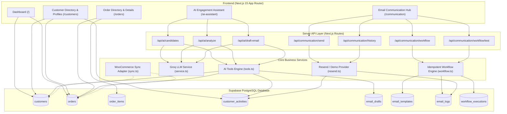

# CommercePilot AI — WooCommerce CRM (Phases 1–7 Complete)

> **Hackathon Status:** Complete Production-Ready Prototype.  
> **Repository:** [https://github.com/JaganParab02/CRM---Kilowatt](https://github.com/JaganParab02/CRM---Kilowatt)  
> **Email Provider:** Resend API integration with safe, transparent Demo Mode (`SIMULATED`).  
> **AI Provider:** Groq LLM API (`openai/gpt-oss-120b`) with deterministic rule-based fallback.

---

## 1. Project Overview

**CommercePilot AI** is an AI-powered Customer Relationship Management (CRM) platform built for WooCommerce businesses. It enables merchants to maintain unified customer profiles, track order lifecycles, autonomously identify high-value follow-up opportunities using evidence from the CRM, generate personalized email drafts, and manage manual and event-triggered email communications with database-enforced idempotency and consent protection.

---

## 2. Technology Stack

- **Frontend Framework:** Next.js 15.5+ (App Router, React 19)
- **Language:** TypeScript 5.9 (Strict mode enabled)
- **Styling:** Tailwind CSS v4 (Design tokens, modern typography, sleek dark mode)
- **Database:** Supabase PostgreSQL with Row Level Security (RLS)
- **Email Delivery:** Resend API with safe server-side Demo Mode fallback
- **Agentic AI:** Groq LLM API (`openai/gpt-oss-120b`) with JSON tool calling and deterministic fallback
- **Client Libraries:** `@supabase/supabase-js` v2

---

## 3. Architecture & Data Flow



---

## 4. Database Schema & Versioned Migrations

All migrations are located in `supabase/migrations/`:

### 1. `001_initial_schema.sql` (Phase 1)
- `customers`: `id`, `first_name`, `last_name`, `email` (auto-normalized to lowercase via PostgreSQL trigger), `phone`, `tags`, `source` (default `demo`), `external_id`, `created_at`, `updated_at`.
- `orders`: `id`, `customer_id` (nullable for guest checkout), `order_number` (unique), `status`, `payment_status`, `fulfillment_status`, `total` (numeric nonnegative check), `currency`, `source`, `external_id`, `ordered_at`, timestamps.
- `order_items`: `id`, `order_id` (FK cascade), `product_name`, `product_external_id`, `quantity`, `unit_price`, `line_total`.
- `customer_activities`: `id`, `customer_id`, `order_id`, `type`, `description`, `created_at`.
- PostgreSQL triggers: `normalize_customer_email` on insert/update; `update_updated_at` timestamps.
- Row Level Security (RLS) enabled on all tables with authenticated/service-role security policies.

### 2. `002_email_drafts.sql` (Phase 3)
- `email_drafts`: `id`, `customer_id` (FK), `order_id` (FK nullable), `subject`, `body`, `status` (`draft`, `reviewed`, `sent`, `discarded`), `ai_generated`, `recommendation_reason`, timestamps.

### 3. `003_communication_module.sql` (Phase 4)
- `email_templates`: `id`, `name`, `subject`, `body`, `category` (`transactional`, `promotional`), `is_active`, timestamps.
- `communication_workflows`: `id`, `name`, `trigger_type` (e.g. `order_completed`), `is_enabled`, `template_id`, timestamps.
- `workflow_executions`: `id`, `workflow_id`, `event_key`, `order_id`, `customer_id`, `status`, `result_details`, `created_at`.
  - **Database-enforced idempotency:** `CONSTRAINT uq_workflow_event UNIQUE (workflow_id, event_key)`.
- `email_logs`: `id`, `customer_id`, `order_id`, `draft_id`, `workflow_id`, `recipient`, `subject`, `body`, `source` (`manual`, `workflow`), `status` (`sent`, `simulated`, `failed`), `provider_message_id`, `error_message`, `is_simulated`, `created_at`.
- `customers.email_opt_out`: Added column to track customer marketing consent.

### 4. `seed.sql` (Phase 1 Data)
- 15 realistic Indian customers (e.g. Aarav Sharma, Sneha Rao, Priya Patel).
- 30 diverse orders covering pending, processing, completed, cancelled, and refunded states.
- Historical completed orders (>60 days inactive) to seed candidates for the AI follow-up engine.

---

## 5. Environment Configuration

Copy `.env.example` to `.env.local`:
```bash
cp .env.example .env.local
```

Required environment variables:
```env
# Supabase Configuration
NEXT_PUBLIC_SUPABASE_URL=https://<your-project-id>.supabase.co
NEXT_PUBLIC_SUPABASE_ANON_KEY=<your-anon-or-publishable-key>
NEXT_PUBLIC_SUPABASE_PUBLISHABLE_KEY=<your-publishable-key>

# AI Provider Configuration (Server-side only)
GROQ_API_KEY=gsk_your_groq_api_key_here

# Resend Email Provider Configuration (Server-side only)
# If left blank or placeholder, the app safely defaults to Demo Mode (SIMULATED)
RESEND_API_KEY=re_your_resend_api_key_here
EMAIL_FROM=CommercePilot <onboarding@resend.dev>
```

---

## 6. Detailed Capabilities by Phase

### Phase 1: Foundation & Data Management
- Supabase client architecture with dual-key fallback (`ANON_KEY` and `PUBLISHABLE_KEY`).
- Server-side database access using `createServerClient()`.
- Data normalization triggers and constraints.

### Phase 2: Core CRM Interface
- **Executive Dashboard (`/`):** Real-time aggregation of active customers, total orders, completed order revenue (without double-counting), and processing counts.
- **Customer Directory (`/customers`):** Search by customer name, email, or phone; filter by segment tags (`#vip`, `#repeat`, `#wholesale`); calculated lifetime spend.
- **Customer Profile (`/customers/[id]`):** Customer metadata, purchase history table, interactive activity timeline, and profile editing.
- **Order Directory (`/orders`):** Status tabs (`All`, `Pending`, `Processing`, `Completed`, `Cancelled`, `Refunded`), search bar, and guest checkout indicators.
- **Order Details (`/orders/[id]`):** Order status, payment & fulfillment badges, customer details card, line items table, and stored totals.

### Phase 3: Agentic AI Customer Engagement (`/ai-assistant`)
- **Tool 1 (`find_follow_up_candidates`):** Server-enforced eligibility:
  - Last completed order was $\ge 60$ days ago.
  - No more recent completed order.
  - Valid email address present.
  - No follow-up recorded within the 30-day cooldown window.
- **Tool 2 (`get_customer_history`):** Authoritative CRM retrieval of customer purchase history, past products bought, order totals, and activity notes.
- **Tool 3 (`create_email_draft`):** Generates warm, personalized email drafts referencing actual items purchased; persists draft with status `draft`.
- **Tool 4 (`log_customer_activity`):** Logs AI evaluations and draft creation events in `customer_activities` with 10-minute deduplication.
- **Deterministic Rule-Based Fallback:** If the LLM API is unavailable, the agent generates transparent, rule-based recommendations labeled `Rule-Based Fallback`.

### Phase 4: Email Communication Workflows (`/communication`)
- **Manual Email Composer:** Select customer, load AI drafts with 1-click, edit subject and body, inspect live WYSIWYG preview, and complete explicit send confirmation.
- **Safe Demo Mode (`SIMULATED`):** When `RESEND_API_KEY` is not configured, operations produce a transparent `SIMULATED` outcome without fake delivery claims or network crashes.
- **Opt-Out & Consent Protection:** Promotional/marketing emails to customers with `email_opt_out: true` are strictly blocked.
- **Automated Workflow (`order_completed`):** Triggers a thank-you email with dynamic order details and support contact info.
- **Idempotency Guarantee:** Backed by database unique constraints on `(workflow_id, event_key)` and in-memory caches to prevent duplicate sends during concurrent or retried requests.
- **Test Workflow Card:** One-click simulation of an order completion event without modifying production order data.
- **Unified Communication History:** Real-time log of all manual and workflow emails with provider message IDs, delivery statuses, error reporting, and customer activity entries.

---

## 7. Future WooCommerce Integration Plan (Phase 5)

CommercePilot AI is architected from the ground up for seamless WooCommerce integration:

1. **Entity Mapping:**
   - Both `customers` and `orders` contain `source` (`'demo'` vs `'woocommerce'`) and `external_id` (WooCommerce ID).
   - [src/types/order.ts](file:///d:/INTERNSHIP/KILOWATT/src/types/order.ts) documents the complete status mapping:
     - WooCommerce `processing` $\rightarrow$ CRM `processing` (Payment: `paid`, Fulfillment: `processing`)
     - WooCommerce `completed` $\rightarrow$ CRM `completed` (Payment: `paid`, Fulfillment: `delivered`)
     - WooCommerce `on-hold` $\rightarrow$ CRM `pending` (Payment: `pending`, Fulfillment: `unfulfilled`)
2. **Service Boundary & Webhook Adapter:**
   - [src/lib/woocommerce/sync.ts](file:///d:/INTERNSHIP/KILOWATT/src/lib/woocommerce/sync.ts) defines:
     - `mapWooCommerceCustomer()`: Converts WooCommerce REST API v3 customer JSON to CRM format.
     - `mapWooCommerceOrder()`: Converts WooCommerce order JSON and line items into CRM entities.
     - `verifyWooCommerceSignature()`: HMAC-SHA256 signature verification for webhook payloads.
3. **Idempotent Synchronization:**
   - When WooCommerce fires `order.created` or `order.updated` webhooks, the system matches on `external_id`, preventing duplicate record creation.

---

## 8. Security Decisions

1. **Server-Side Credential Isolation:**
   - `GROQ_API_KEY`, `RESEND_API_KEY`, and `SUPABASE_SERVICE_ROLE_KEY` are only ever accessed in Next.js Server Components, Server Actions, or Route Handlers.
   - Keys are never bundled into client-side JavaScript.
2. **Database Row Level Security (RLS):**
   - RLS is enabled on all tables in `001_initial_schema.sql` and `003_communication_module.sql`.
3. **Authorization & ID Validation:**
   - Server-side routes validate customer IDs and order IDs against the database before executing any action. Client-supplied IDs are never trusted blindly.
4. **Agent Action Boundaries:**
   - The AI agent has zero ability to execute arbitrary SQL, run code, or trigger email delivery directly. It can only call predefined, safe tools.

---

## 9. Testing & Verification Checklist

| Test Suite / Capability | Command / Method | Result |
| :--- | :--- | :--- |
| **TypeScript Strict Checking** | `npm run type-check` (`tsc --noEmit`) | **Passed (0 errors)** |
| **ESLint Validation** | `npm run lint` | **Passed (0 warnings, 0 errors)** |
| **Production Build** | `npm run build` | **Passed (All 16 routes compiled)** |
| **Workflow API** | `GET /api/communication/workflow` | **Passed (Workflow active, template loaded)** |
| **Manual Send (Demo Mode)** | `POST /api/communication/send` | **Passed (`status: simulated`, `isSimulated: true`)** |
| **Opt-Out Blocking** | `POST /api/communication/send` to opted-out `Sneha Rao` | **Passed (Delivery blocked: Customer opted out)** |
| **Automated Workflow Test** | `POST /api/communication/workflow/test` | **Passed (Simulated thank-you email generated)** |
| **Idempotency Protection** | Re-running test workflow with same order ID | **Passed (Duplicate execution prevented)** |
| **Communication History** | `GET /api/communication/history` | **Passed (All simulated outcomes logged)** |

---

## 10. Demo Walkthrough Video Plan

Here is the recommended 8-step walkthrough for evaluating CommercePilot AI:

1. **Dashboard Overview (`/`):** View real-time KPIs (Total Customers, Total Orders, Completed Revenue, Orders Processing) and the 5 most recent orders.
2. **Customer Directory & Profile (`/customers` & `/customers/[id]`):** Search for `Aarav Sharma`, view tags (`#vip`), lifetime spend, order history table, and activity timeline.
3. **Order Directory & Details (`/orders` & `/orders/[id]`):** Filter orders by status tab (`Completed`), click an order (`KW-1001`), and review line items and totals.
4. **AI Follow-Up Opportunity Scan (`/ai-assistant`):** Click **Find Candidates**. Observe the agent selecting customers inactive for >60 days with supporting evidence.
5. **AI Analytical Evaluation & Draft Generation:** Click **Analyze Customer & Draft Email**. Watch the Groq AI agent evaluate CRM purchase history and generate a personalized draft referencing past products.
6. **Email Hub & Manual Composer (`/communication`):** Select customer, click **Load into Composer** on the AI draft, inspect live WYSIWYG preview, check explicit confirmation, and click **Send Approved Email**. Note the transparent `SIMULATED` outcome.
7. **Opt-Out Enforcement:** Select `Sneha Rao` (opted out), toggle promotional flag, and observe the delivery block.
8. **Automated Order Completion Workflow:** View the `order_completed` workflow card, click **Test Workflow**, observe idempotent execution, and verify the resulting entry in **Communication History**.

---

## 11. Known Limitations & Future Work

- **Live WooCommerce Sync:** Currently operates using seeded demo data and documented adapter boundaries; live webhooks require a publicly accessible WooCommerce domain and API credentials.
- **Multi-Channel Communication:** SMS and WhatsApp channels are not implemented in this phase; email is the single communication channel.
- **Email Delivery Provider:** Requires a valid `RESEND_API_KEY` for real inbox delivery; otherwise runs in safe Demo Mode (`SIMULATED`).

---

## 12. Local Development & Verification Commands

```bash
# 1. Clone repository
git clone https://github.com/JaganParab02/CRM---Kilowatt.git
cd CRM---Kilowatt

# 2. Install dependencies
npm install

# 3. Configure environment
cp .env.example .env.local
# (Fill in your Supabase & Groq API credentials)

# 4. Run TypeScript and linter checks
npm run type-check
npm run lint

# 5. Build for production
npm run build

# 6. Start development server
npm run dev
# Access http://localhost:3000
```
